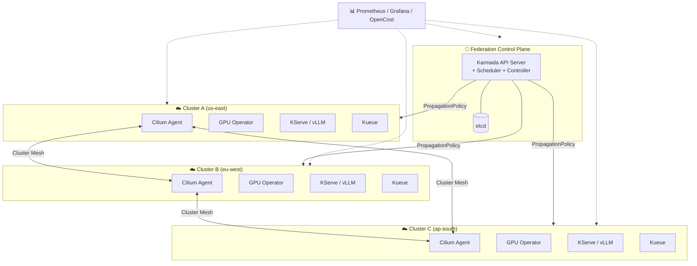

# 🌐 Multi-Cluster GPU Inference Fleet — Terraform Stack

> Provision and operate multiple Kubernetes clusters as a single extended cluster for large-scale NVIDIA GPU inference — using Terraform for every layer.

[](https://www.terraform.io/)
[](https://kubernetes.io/)
[](https://github.com/NVIDIA/gpu-operator)
[](https://karmada.io/)
[](https://cilium.io/)

---

## 📖 Table of Contents

- [Overview](#-overview)
- [Architecture](#-architecture)
- [Repository Structure](#-repository-structure)
- [1. Foundational Cloud Infrastructure](#️-1-foundational-cloud-infrastructure-per-cluster)
- [2. Multi-Cluster Control Plane (Karmada)](#️-2-multi-cluster-control-plane-karmada)
- [3. Cross-Cluster Networking (Cilium Cluster Mesh)](#-3-cross-cluster-networking-cilium-cluster-mesh)
- [4. GPU Lifecycle Management (NVIDIA GPU Operator)](#-4-gpu-lifecycle-management-nvidia-gpu-operator)
- [5. Inference Orchestration Layer](#-5-inference-orchestration-layer)
- [6. Observability & Cost Governance](#-6-observability--cost-governance)
- [7. Image & Model Distribution](#-7-image--model-distribution-optional-but-recommended)
- [Component Summary](#-component-summary)
- [Getting Started](#-getting-started)

---

## 🎯 Overview

This repository contains the Terraform stack to build a **multi-cluster GPU inference fleet**. Instead of one massive cluster, we operate several regional clusters that behave as a single logical cluster through:

- **Karmada** — unified control plane (single Kubernetes API)
- **Cilium Cluster Mesh** — unified pod network
- **NVIDIA GPU Operator** — unified GPU lifecycle
- **Kueue + KServe / vLLM** — unified inference scheduling and serving

This pattern is ideal for large-scale inference where no single cluster has enough GPUs, and where latency, cost, and capacity vary by region.

---

## 🏗️ Architecture



---

## 📁 Repository Structure

```
.
├── README.md
├── environments/
│   ├── prod/
│   │   ├── main.tf
│   │   ├── variables.tf
│   │   └── terraform.tfvars
│   └── staging/
│       ├── main.tf
│       ├── variables.tf
│       └── terraform.tfvars
├── modules/
│   ├── cluster/                 # Cloud K8s + GPU node groups
│   ├── karmada/                 # Federation control plane
│   ├── cilium-mesh/             # Cilium + Cluster Mesh
│   ├── gpu-operator/            # NVIDIA GPU Operator
│   ├── kueue/                   # MultiKueue
│   ├── kserve-vllm/             # Model serving stack
│   └── observability/           # Prometheus/Grafana/OpenCost
└── policies/
    ├── propagation-policies.yaml
    ├── override-policies.yaml
    └── cluster-queues.yaml
```

---

## 🏛️ 1. Foundational Cloud Infrastructure (per cluster)

Each Kubernetes cluster must first exist with GPU-capable nodes. Terraform provisions the managed Kubernetes service (EKS, AKS, GKE) along with dedicated node groups.

### Key Terraform resources / modules

| Component | Terraform Module | Notes |
|---|---|---|
| **Cluster** | `terraform-aws-modules/eks/aws` | Control plane, IAM, security groups |
| **GPU Node Group** | Managed node group with `g6e.8xlarge`, `p4d.24xlarge`, `a3-highgpu-8g` | Taints: `nvidia.com/gpu:NoSchedule`; Labels: `accelerator=nvidia-gpu` |
| **EFA / high-speed networking** | EFA-enabled node group + placement group | Required for multi-node tensor parallelism |
| **Model storage** | EFS / FSx for Lustre | Shared filesystem for model checkpoints |

### Example

```hcl
module "gpu_node_group" {
  source = "terraform-aws-modules/eks/aws//modules/eks-managed-node-group"

  cluster_name    = module.eks.cluster_name
  cluster_version = "1.30"

  instance_types = ["g6e.8xlarge"]
  capacity_type  = "ON_DEMAND"

  taints = [{
    key    = "nvidia.com/gpu"
    value  = "present"
    effect = "NO_SCHEDULE"
  }]

  labels = {
    accelerator = "nvidia-gpu"
    workload    = "inference"
  }

  enable_efa_support = true
  placement_group_name = aws_placement_group.gpu_pg.name
}
```

> **Why this layer matters:** Without Terraform-managed node groups, GPU node drift (mismatched drivers, missing device plugins) silently breaks inference. IaC enforces consistent GPU node configuration across every cluster in the fleet.

---

## ☸️ 2. Multi-Cluster Control Plane (Karmada)

[Karmada](https://karmada.io/) provides a **federation control plane** presenting multiple member clusters through a single Kubernetes API. It does not replace underlying clusters; it sits above them.

### Control plane components

- **Karmada API Server** — unified entry point for workloads
- **Karmada Controller Manager** — propagates resources to members
- **Karmada Scheduler** — places workloads via `PropagationPolicy`
- **etcd** — federation state store

### Key CRDs managed by Terraform

| CRD | Purpose |
|---|---|
| **`PropagationPolicy`** | Map a Deployment/InferenceService to member clusters, define replica distribution (e.g. 70% east / 30% west) |
| **`OverridePolicy`** | Rewrite cluster-specific fields (image registry, StorageClass, GPU type) |
| **`FederatedHPA`** | Horizontal autoscaling across clusters on aggregate GPU util |

### Example `PropagationPolicy`

```yaml
apiVersion: policy.karmada.io/v1alpha1
kind: PropagationPolicy
metadata:
  name: vllm-inference
spec:
  resourceSelectors:
    - apiVersion: serving.kserve.io/v1beta1
      kind: InferenceService
      name: llama-3-70b
  placement:
    clusterAffinity:
      clusterNames: [us-east, eu-west, ap-south]
    replicaScheduling:
      replicaSchedulingType: Divided
      replicaDivisionPreference: Weighted
      weightPreference:
        staticWeightList:
          - targetCluster: { clusterNames: [us-east] }
            weight: 50
          - targetCluster: { clusterNames: [eu-west] }
            weight: 30
          - targetCluster: { clusterNames: [ap-south] }
            weight: 20
```

> **Why Karmada:** It reached CNCF graduation and is purpose-built for spreading GPU/AI workloads across clusters when no single cluster has enough accelerators.

---

## 🌐 3. Cross-Cluster Networking (Cilium Cluster Mesh)

[Cilium Cluster Mesh](https://docs.cilium.io/en/stable/network/clustermesh/) connects pod networks of all member clusters into **one logical network** — enabling cross-cluster pod-to-pod connectivity, global service discovery, and cross-cluster load balancing without a per-service ingress or VPN.

### Terraform implementation

- Deploy **Cilium** as CNI via `helm_release` on every cluster
- Enable **Cluster Mesh** with shared `cluster-name` / `cluster-id`
- Define **global services** so inference requests route to any healthy replica

### Example

```hcl
resource "helm_release" "cilium" {
  name       = "cilium"
  namespace  = "kube-system"
  repository = "https://helm.cilium.io"
  chart      = "cilium"
  version    = "1.17.0"

  values = [yamlencode({
    cluster = {
      name = var.cluster_name
      id   = var.cluster_id
    }
    clustermesh = {
      useAPIServer         = true
      apiserverServiceType = "NodePort"
      config = {
        enabled = true
      }
    }
    ipam = { mode = "cluster-pool" }
  })]
}
```

### Why this is critical for GPU inference

- **Capacity spillover:** A request arriving at a saturated cluster is transparently forwarded to a pod in another cluster with free GPU.
- **Disaggregated inference:** Pre-processing in one cluster, GPU inference in another, post-processing in a third — all over the mesh.

---

## 🎮 4. GPU Lifecycle Management (NVIDIA GPU Operator)

The [NVIDIA GPU Operator](https://github.com/NVIDIA/gpu-operator) automates the entire GPU software stack per node: driver installation, container runtime config, device plugin, MIG manager, and DCGM metrics exporter.

### Terraform implementation

- Install via **Helm** as a `helm_release` on every member cluster
- Set `driver.enabled=false` if the cloud node image already ships with a driver
- Enable **MIG** (A100/H100) or **time-slicing** for smaller services

### GPU sharing strategies

| Strategy | Use Case |
|---|---|
| **MIG** | Hardware partitioning, strict isolation, multi-tenant inference |
| **MPS** | Multiple CUDA processes sharing a GPU; small-batch or parallelizable jobs |
| **Time-slicing** | Oversubscription for bursty, non-latency-critical workloads |

### Example

```hcl
resource "helm_release" "gpu_operator" {
  name             = "gpu-operator"
  namespace        = "gpu-operator"
  create_namespace = true
  repository       = "https://helm.ngc.nvidia.com/nvidia"
  chart            = "gpu-operator"
  version          = "v25.3.0"

  set {
    name  = "driver.enabled"
    value = "false"   # cloud AMI already has driver
  }
  set {
    name  = "migManager.enabled"
    value = "true"
  }
}
```

> The GPU Operator is the **node-level complement** to Karmada's cluster-level scheduling. Karmada decides *which cluster* receives a workload; the GPU Operator ensures that cluster's GPUs are discoverable and efficiently shared.

---

## 🚀 5. Inference Orchestration Layer

### A. Kueue (multi-cluster job queueing)

[Kueue](https://kueue.sigs.k8s.io/) provides queue-based admission control for GPU-hungry workloads. With **MultiKueue**, one control cluster dispatches jobs to the cheapest/most-available GPU pool across regions.

- Terraform installs Kueue via Helm
- Configure `ResourceFlavor` and `ClusterQueue` CRDs mapped to GPU node pools

```yaml
apiVersion: kueue.x-k8s.io/v1beta1
kind: ClusterQueue
metadata:
  name: gpu-inference-queue
spec:
  namespaceSelector: {}
  resourceGroups:
    - coveredResources: ["nvidia.com/gpu"]
      flavors:
        - name: a100-flavor
          resources:
            - name: nvidia.com/gpu
              nominalQuota: 64
```

### B. KServe / vLLM (model serving)

- **KServe** provides the `InferenceService` CRD with scale-to-zero and canary rollouts. Terraform deploys the controller via Helm.
- **vLLM** is the recommended engine for LLMs. For multi-node tensor parallelism, deploy vLLM behind **LeaderWorkerSet (LWS)** on EFA-enabled node groups.
- Terraform creates the ECR repository for the vLLM image and the LWS Helm release.

### C. Gateway / API layer

- **Envoy Gateway** or **Istio multi-primary mesh** routes inference requests, enforces API-key auth, and applies rate limits.

---

## 📊 6. Observability & Cost Governance

Operating a multi-cluster GPU fleet without centralized observability is untenable.

| Component | Purpose |
|---|---|
| **Prometheus + Grafana + Loki** | Per-cluster metrics/logs, federated to a central Grafana |
| **DCGM Exporter** | GPU utilization, memory, temperature, ECC errors |
| **Karmada metrics** | Propagation latency, cluster health |
| **OpenCost** | GPU cost per namespace / per model endpoint |

Terraform deploys all of these via Helm; Grafana datasources are federated through a central Prometheus (Thanos or Mimir recommended).

---

## 📦 7. Image & Model Distribution (optional but recommended)

Cold-start latency dominates GPU inference cost. Terraform can provision:

- **P2P image distribution** (Zot + Spegel) for peer-to-peer pulls
- **Geo-replicated container registry** (ECR replication, ACR geo-replication)
- **Shared model weights filesystem** mounted across GPU nodes so new pods start serving without downloading multi-GB weights

---

## 📋 Component Summary

| Layer | Terraform-managed component | Role |
|---|---|---|
| **Cloud infra** | EKS/AKS/GKE module + GPU node groups + EFA | Provision clusters and GPU nodes with taints, labels, networking |
| **Federation** | Karmada + `PropagationPolicy` / `OverridePolicy` | Unified API; place workloads by GPU capacity and region |
| **Networking** | Cilium Cluster Mesh | Connect pod networks; global services, cross-cluster LB |
| **GPU lifecycle** | NVIDIA GPU Operator | Drivers, device plugin, MIG/time-slicing, GPU metrics |
| **Inference scheduling** | Kueue MultiKueue + KServe/vLLM + LWS | Queue jobs, serve models, scale across GPU pools |
| **Observability** | Prometheus / Grafana / Loki / OpenCost | GPU utilization, federation health, cost tracking |

> **Key architectural insight:** No single component makes clusters "extended." **Karmada** provides the logical single API, **Cilium Cluster Mesh** provides the single network, and **GPU Operator + Kueue** provide a unified GPU scheduling surface. **Terraform** is what makes this repeatable — every new GPU region or cluster is provisioned consistently with the rest of the fleet.

---

## 🚀 Getting Started

### Prerequisites

- Terraform ≥ 1.5
- Cloud credentials with permissions for EKS/AKS/GKE, EC2/VM, EFS/FSx
- `kubectl` and `helm` installed locally
- Domain name (optional) for Karmada and inference endpoints

### Bootstrap

```bash
# 1. Clone
git clone https://github.com/<your-org>/gpu-fleet-terraform.git
cd gpu-fleet-terraform

# 2. Configure environments/prod/terraform.tfvars
cp environments/prod/terraform.tfvars.example environments/prod/terraform.tfvars
$EDITOR environments/prod/terraform.tfvars

# 3. Provision clusters + GPU nodes
cd environments/prod
terraform init
terraform plan -out=tfplan
terraform apply tfplan

# 4. Fetch kubeconfigs
aws eks update-kubeconfig --name gpu-fleet-us-east   --alias us-east
aws eks update-kubeconfig --name gpu-fleet-eu-west   --alias eu-west
aws eks update-kubeconfig --name gpu-fleet-ap-south  --alias ap-south

# 5. Verify federation
kubectl --context karmada get clusters
kubectl --context karmada get propagationpolicy -A
```

### Verify GPU health

```bash
kubectl --context us-east get nodes -l accelerator=nvidia-gpu
kubectl --context us-east get pods -n gpu-operator
kubectl --context us-east get pods -n kube-system -l k8s-app=cilium
```

### Deploy a sample inference workload

```bash
kubectl --context karmada apply -f policies/propagation-policies.yaml
kubectl --context karmada apply -f examples/llama-3-70b-inferenceservice.yaml
kubectl --context karmada get inferenceservice -A
```

---

## 📚 References

- [Karmada documentation](https://karmada.io/docs/)
- [Cilium Cluster Mesh](https://docs.cilium.io/en/stable/network/clustermesh/)
- [NVIDIA GPU Operator](https://docs.nvidia.com/datacenter/cloud-native/gpu-operator/latest/)
- [Kueue MultiKueue](https://kueue.sigs.k8s.io/docs/concepts/multikueue/)
- [KServe](https://kserve.github.io/website/)
- [vLLM production stack](https://github.com/vllm-project/production-stack)

---

## 📄 License

Apache 2.0 — see [LICENSE](LICENSE).

---

*Maintained by the Platform Engineering team. For questions, open an issue or ping `#gpu-fleet` on Slack.*